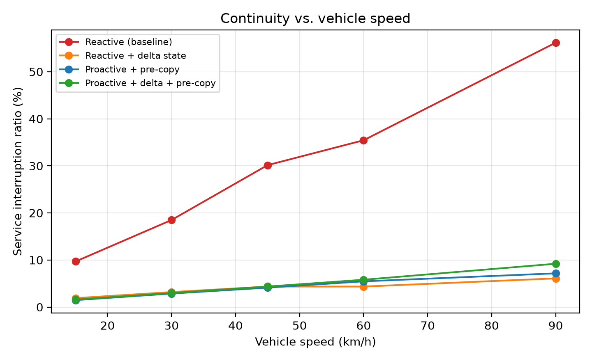
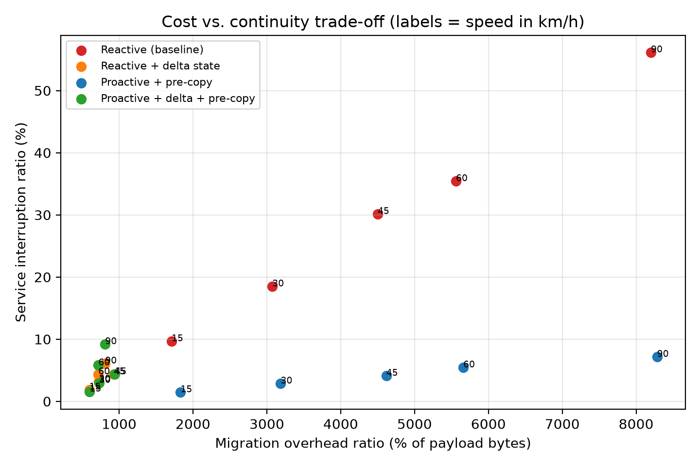

# MyEdgeSimPy

基于 [EdgeSimPy](https://github.com/EdgeSimPy/EdgeSimPy) 的 **MEC 服务状态迁移** 仿真原型。

目标场景：车辆（终端）在城市中移动，跨越不同基站/边缘节点时发生服务切换。**核心问题**是
如何在节点之间快速迁移服务的数据与状态、保持业务连续性，并且（下一阶段）不让外部攻击者
通过观测迁移行为反推车辆轨迹。

当前版本完成的是 **baseline prototype**：健康、可运行、可复现的迁移仿真，不含任何安全机制，
但已经把安全分析需要的"可观测侧信道"完整记录下来，为第二阶段留好接口。

---

## 1. 快速开始

```bash
# 1) 安装依赖（EdgeSimPy 不在 PyPI 上，需要从 GitHub 安装）
python scripts/bootstrap.py

# 2) 看看四类 MEC 服务的定义
python -m myedgesimpy services

# 3) 只建场景、不仿真：检查拓扑、车辆轨迹、握手次数
python -m myedgesimpy inspect --config configs/small.yaml

# 4) 跑一次完整实验
python -m myedgesimpy run --config configs/default.yaml

# 5) 跑"策略 x 车速"扫描，并画图
python -m myedgesimpy sweep --config configs/default.yaml \
       --speeds 15,30,45,60,90 \
       --strategies reactive,reactive_delta,proactive,proactive_delta \
       --out results/sweep
python -m myedgesimpy plot --sweep results/sweep/sweep_summary.csv

# 6) 自检（改完代码后建议跑一次）
python scripts/smoke_test.py
```

一次 `default` 配置（6x6 蜂窝、12 辆车、1800 步）大约 9 秒。

---

## 2. 目录结构

```
myedgesimpy/
  config.py                 # 所有实验参数（YAML -> dataclass）
  topology/graph.py         # 蜂窝拓扑：规则网格 或 真实基站站点(DATA7)
  mobility/paths.py         # 车辆路径 + 按时速展开成逐步 cell 轨迹
  mobility/taxi.py          # Rome / San Francisco 出租车轨迹加载与映射
  services/catalog.py       # 四类 MEC 服务：状态、镜像、上下行、算力
  scenario/builder.py       # 组装 EdgeSimPy 输入数据集（attributes + relationships）
  migration/strategies.py   # 策略预设（何时迁移 / 迁多少 / 如何保持可用）
  migration/controller.py   # 迁移控制器 = EdgeSimPy 的 resource_management_algorithm
  metrics/collector.py      # 连续性 / 成本 / 可观测侧信道 三类指标
  runner/experiment.py      # 单次实验
  runner/sweep.py           # 参数扫描
  analysis/plots.py         # 出图
  cli.py                    # 命令行入口
configs/                    # 实验配置
scripts/                    # bootstrap + smoke test
docs/                       # 设计文档与研究路线
results/                    # 仿真输出（已 gitignore）
```

---

## 3. 场景是怎么建的

### 3.1 拓扑

- `topology.source: grid`（默认）：`grid_x × grid_y` 规则蜂窝，每个 cell = 一个基站 +
  一个网络交换机 + 一个边缘服务器，相邻 cell 之间光纤互连。
- `topology.source: sites`：读取真实基站站点 CSV（DATA7 等），按"就近邻接 + 最小生成树"
  连成连通图。见第 6 节。

链路参数：`link_delay_ms`（毫秒，直接进入时延计算）与 `link_bandwidth_mbps`（会在建库时
换算成 "每个仿真步可传输多少 MB"，因为 EdgeSimPy 的流是以"每步传输量"推进的）。

### 3.2 车辆移动（问题 1 的答案）

关键是**把移动速度做成一个可观测量**：

```
ticks_per_cell = cell_size_m / (speed_m_per_s × tick_seconds)
```

即"车开完一个 cell 需要多少个仿真步"。同一条路径在不同速度下被"回放"，速度越快，
每个 cell 停留越短、切换越频繁。`mobility/paths.py` 负责把路径展开成**逐步 cell 轨迹**
（每辆车、每一步在哪个 cell），EdgeSimPy 的 `User.step()` 每步读取该轨迹，
`BaseStation.find_by(coordinates=...)` 自动把终端接到当前 cell 的基站，从而产生
**handover**；边缘服务器就挂在该基站下，于是 handover 直接对应"服务应该换节点"。

真实数据集接入：`mobility/taxi.py` 把 Rome / San Francisco 的经纬度折线映射到仿真网格，
保留相对形状与顺序（决定切换序列与频率），再按上面的公式调速回放。

### 3.3 MEC 服务与数据流（问题 2 的答案）

四类服务定义在 `services/catalog.py`，每类都显式给出"终端传什么 / 边缘算什么 / 返回什么"：

| 服务 | 终端上传 | 边缘计算 | 返回终端 | 可迁移状态 | 镜像 |
|---|---|---|---|---|---|
| navigation 导航辅助 | GPS、航向、路径请求 | 区域地图图上的路径重规划、危险图层 | 逐转指令、更新后的路径段 | 5 MB (+0.01 MB/s) | 370 MB |
| infotainment 信息娱乐 | 播放位置、码率提示、分片请求 | 转码/选片、广告插入、缓冲管理 | 音视频分片、播放列表 | 200 MB (+0.15 MB/s) | 540 MB |
| alert 上下文感知告警 | 传感器快照、车辆遥测 | 上下文匹配、地理围栏 | 带等级与位置的告警 | 3 MB (+0.005 MB/s) | 205 MB |
| traffic_analytics 实时交通分析 | 探针样本（位置/速度）、雷达摘要 | 时空聚合与短时流量预测 | 拥堵指数、预测行程时间热力图 | 80 MB (+0.10 MB/s) | 295 MB |

**建模选择**：每辆车 × 每类服务 = 一个独立的 `Service` 实例。也就是说，"迁移某车的
navigation 服务"就是"迁移该用户在边缘侧的会话状态"，这与 MEC 里"用户状态跟随用户移动"
的语义一致。镜像按 Docker 分层建模，只有目标节点没缓存的层才会被拉取
（EdgeSimPy 的 container registry 机制），因此稳态下迁移成本 ≈ 状态传输成本，
首次到某节点才有镜像拉取成本。

### 3.4 四种迁移策略（问题 4 的第一部分）

策略 = 三个正交决策的组合，定义在 `migration/strategies.py`：

| 预设 | 何时迁移 | 迁多少 | 传输期间可用性 |
|---|---|---|---|
| `reactive`（baseline） | 切换**之后**再迁 | 全量状态 | stop-and-copy：传输期间服务不可用 |
| `reactive_delta` | 切换之后再迁 | 只迁**增量**状态 | stop-and-copy |
| `proactive` | 用前视窗口在切换**之前**预迁移 | 全量状态 | pre-copy：源节点继续服务，只在切点短暂中断 |
| `proactive_delta` | 预迁移 | 增量状态 | pre-copy |

- **前视**：控制器读取车辆轨迹，若 `lookahead_steps` 步内将要离开当前 cell，就提前把状态
  迁到目标 cell 的边缘服务器。当前实现用的是"理想预测"（上界），真实部署应换成轨迹预测
  器，接口已经留好（只需替换 `_target_coordinates`）。
- **增量**：每个服务记录上次同步快照，只传 `当前状态 - 上次同步`。
- **pre-copy**：批量传输期间源节点继续服务（EdgeSimPy 会把服务置为不可用，控制器按策略
  在每步重新置为可用）；整辆车所有服务都到位后，只计一次 `cutover_steps` 的切换中断
  （make-before-break）。

---

## 4. 指标（问题 3 的答案）

`metrics/collector.py` 采集三类指标：

**连续性（用户体验）**
- `service_interruption_ratio`：至少有一个服务不可用的"车辆-步"占比（主指标）
- `unavailable_service_ratio`：不可用服务的占比
- `mean_delay_ms`、`sla_violation_ratio`：端到端时延及 SLA 违约比例

**成本（运营商开销）**
- `migrations_started/completed`、`mean/p95_migration_duration_steps`
- 迁移时长分解：`waiting`（排队）/ `pulling`（拉镜像）/ `state`（状态传输）
- `state_mb_total`、`image_mb_total`、`migration_mb_total`
- `overhead_ratio` = 迁移字节 / 业务载荷字节（**开销比**）
- `mean_link_utilisation`（控制面压力的代理指标）
- `migrations_denied_capacity`（目标节点容量不足而被拒绝）

**可观测侧信道（安全阶段的 ground truth）**
- `observable_migration_trace.json`：每条迁移的 `(发生时刻, 源节点, 目标节点, 字节数)`
  ——正是外部攻击者能看到的信息；`handovers.csv` 给出真实轨迹作为对照。

---

## 5. 当前结果速览

`configs/default.yaml`（6x6、12 辆车、1800 步）在五种车速下的结果：

服务中断比例（%）

| 策略 | 15 | 30 | 45 | 60 | 90 km/h |
|---|---|---|---|---|---|
| reactive（baseline） | 9.7 | 18.5 | 30.1 | 35.4 | 56.2 |
| reactive_delta | 1.9 | 3.2 | 4.4 | 4.4 | 6.1 |
| proactive | 1.5 | 2.9 | 4.1 | 5.5 | 7.2 |
| proactive_delta | 1.6 | 3.0 | 4.4 | 5.8 | 9.2 |





可以读出的结论：
1. **车速是主导变量**：baseline 的中断比例随速度近似线性恶化（cell 停留时间缩短，
   但状态传输时间不变）。
2. **增量状态最划算**：字节量和开销比都降一个量级，且不依赖预测。
3. **pre-copy 决定连续性**：全量状态 + pre-copy 也能把中断压到个位数百分比，
   但字节成本不变——这正是"延迟 vs 成本"的权衡面。
4. 高速下 `proactive_delta` 反而略差于 `reactive_delta`：预迁移会因路线改变而多做迁移，
   而增量传输本来就很快——**预测质量**因此成为一个值得研究的点。

---

## 6. 接入真实数据集

### Rome / San Francisco 出租车轨迹

```yaml
mobility:
  source: taxi
  dataset: sf          # 仅用于记录来源
  dataset_path: data/sf_taxi.csv
  vehicles: 12
  speed_kmh: 40.0
  cell_size_m: 500.0
```

`mobility/taxi.py` 支持两种输入：

1. **单个 CSV**（推荐）：表头包含 `taxi_id, timestamp, lat, lon`。
2. **每车一个文件的目录**（CRAWDAD `roma/taxi` 风格）：文件内容可以是
   JSON `POLYLINE`（`[[lat,lon],...]`）或按行排列的数值；列角色会按取值范围自动识别
   （纬度 ∈ [-90,90]、经度 ∈ [-180,180]、时间戳按数量级）。

轨迹会被映射到仿真网格（对轨迹包围盒做线性缩放，纬度方向翻转以匹配 y 轴）。

### DATA7 基站拓扑

```yaml
topology:
  source: sites
  sites_path: data/data7_sites.csv     # 至少包含 latitude, longitude（可含 id）
  sites_k_neighbors: 3
```

`topology/graph.py::load_sites_csv` 支持 `lat/latitude/y`、`lon/lng/long/longitude/x`
等列名别名；站点被吸附到以"中位最近邻距离"为步长的格点上，再按 k 近邻 + 最小生成树
连成连通拓扑。

---

## 7. 建模假设与已知限制

写论文前请务必知道这些假设（细节见 `docs/design.md`）：

1. **镜像缓存**：初始被占据的节点已经缓存了所需镜像；只有迁移到"没缓存的节点"才付拉镜像成本。
2. **状态增长是线性的**，由服务配置给出；增量迁移只传自上次同步以来的增量。
3. **pre-copy 的可用性由策略定义**：批量传输期间服务保持可用，切换中断固定为
   `cutover_steps` 步。EdgeSimPy 原生会在状态流创建的那一步把服务置为不可用，因此
   pre-copy 下存在 **1 个仿真步的建模伪影**（已在控制器 `post_step()` 中尽量消除）。
4. **前视是"理想预测"**：使用真实轨迹的前视窗口，等价于预测准确率 100% 的上界。
5. **字节记账是解析式**：迁移字节 = 状态字节 + 未缓存镜像层字节，而不是从网络流采样累加
   （流的 `data_to_transfer` 会随推进递减）。
6. **端到端时延**取自 EdgeSimPy 的 `User.delays`，只在"位置变化"或"迁移完成"时重算；
   因此 `mean_delay_ms` 只统计可用服务的时延，SLA 违约则把"服务不可用"直接计为违约。

---

## 8. 下一步

- **安全阶段**：威胁模型、防御族、评估指标与代码钩子见
  [`docs/research_roadmap.md`](docs/research_roadmap.md)。
- **系统优化阶段**：迁移策略 / 迁移底层优化 / 延迟-成本平衡三个方向的 TODO 清单，
  同样在该文档中，并标注了对应的代码位置。